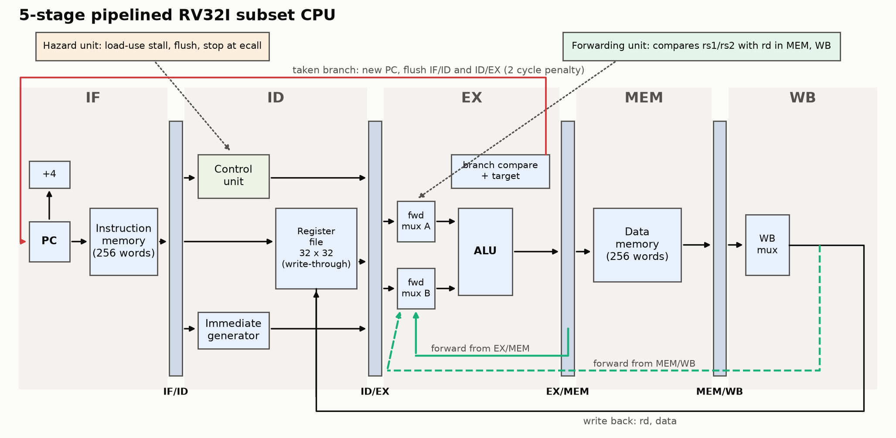

# 5-Stage Pipelined RISC-V Processor

**Team: Processors Assemble!**

**Section:** E

Modern Computer Architecture, Verilog Project 3 — NST, Rishihood University.

We build a single-cycle RV32I subset CPU, split it into a five-stage pipeline
(IF, ID, EX, MEM, WB), and measure what pipelining does to CPI, clock frequency and
execution time. The pipeline runs in two modes: with forwarding (stalls only on
load-use) and without (stalls on every read-after-write hazard).

## Team members

| Name | Enrolment number | GitHub | Role |
|---|---|---|---|
| Sarvesh Srinath | 2401010423 | [@sarveshcore](https://github.com/sarveshcore) | CPU RTL, pipeline and hazard units, assembler, reference model and tooling |
| Trishit Swarnakar | 2401010480 | [@Trishix](https://github.com/Trishix) | Verification, directed tests and annotated waveforms |
| Aryan Kumar | 2401020014 | [@Ario2006](https://github.com/Ario2006) | Single-cycle datapath and control review |
| Husain Khorakiwala | 2401010192 | [@AvgBlank](https://github.com/AvgBlank) | Synthesis and performance analysis, review, final report and submission |
| Navodit Sharma | 2401010294 | [@Navodit-AI](https://github.com/Navodit-AI) | Background and related work, report assembly, slides and demo video |

## Architecture



## Status

The single-cycle CPU and both pipeline configurations are implemented and checked
against the reference ISS with 248 automated tests. Synthesis and benchmark results,
annotated hazard waveforms and the [project report (PDF)](report/main.pdf) are available.
Watch the [Phase I video](https://github.com/Ario2006/risc-5-processor/blob/main/docs/video/phase1-video.mp4).

## Phase I Demo Video

https://github.com/user-attachments/assets/32aab2c7-add4-4730-a6ef-789802c4ad09

**[Watch the Phase I video (4:22)](https://github.com/Ario2006/risc-5-processor/blob/main/docs/video/phase1-video.mp4)**.
If it doesn't play in your browser, [download it](https://github.com/Ario2006/risc-5-processor/raw/main/docs/video/phase1-video.mp4).
The [demo script](docs/demo.md) walks through the same demo step by step.

## Results

All numbers come from `results/`, made by `make synth perf`. Fmax is the median of five
nextpnr seeds on a Lattice ECP5 LFE5U-25F (speed grade 6), with memories in LUT RAM.

| CPU | Fmax (MHz) | Logic cells | Flip-flops | CPI range over 5 benchmarks |
|---|---|---|---|---|
| Single-cycle | 58.75 | 2076 | 43 | 1.00 |
| Pipeline, no forwarding | 113.86 | 2137 | 299 | 1.51 to 2.74 |
| Pipeline, forwarding | 83.89 | 2765 | 308 | 1.26 to 1.58 |

Execution time speedup over single-cycle (cycles divided by Fmax):

| Benchmark | No forwarding | Forwarding |
|---|---|---|
| bubble_sort | 0.94x | 0.98x |
| dep_chain | 0.71x | 1.14x |
| fibonacci | 1.14x | 1.11x |
| indep_ops | 1.29x | 1.13x |
| sum_array | 0.90x | 0.90x |

The pipeline roughly doubles the clock, but loses most of that to taken branch flushes
(two cycles each, once per loop iteration) and, without forwarding, to data hazard
stalls. Forwarding removes almost every stall but adds a mux and a comparator to the
slowest path, so its clock is lower. The report explains each number:
`report/sections/results.tex`.

## Setup

You need Python 3.11 to 3.14, [uv](https://docs.astral.sh/uv/) and Icarus Verilog 12 or newer.

```sh
# macOS
brew install icarus-verilog            # optional: brew install yosys (faster synthesis)
# Ubuntu / WSL
sudo apt-get install iverilog
# Windows without WSL: install Icarus from https://bleyer.org/icarus/ and tick "add to PATH"

uv sync                                # Python tools, plus YoWASP yosys and nextpnr for synthesis
make test                              # 248 tests, about 3 seconds
```

No `make` on Windows? Run the commands inside `Makefile` by hand, for example
`uv run pytest -q`.

## Commands

| Command | What it does |
|---|---|
| `make test` | assembler and ISS unit tests, then every program on all three CPUs, checked against the ISS |
| `make synth` | Yosys and nextpnr for all CPUs and both memory styles, five seeds (about 3 minutes) |
| `make perf` | runs the benchmarks, writes `results/cpi.csv` and `results/performance.csv` |
| `make figures` | redraws everything in `figures/` |
| `make demo` | runs the hazard demo and writes `build/hazard_demo.vcd` for GTKWave or Surfer |
| `uv run python -m tools.sim prog.s --config pipe_fwd` | runs one program and checks it |

## Instruction set

RV32I subset, 32 bit, little endian, word sized memory access only.

| Type | Instructions |
|---|---|
| R | `add sub and or xor slt sll` |
| I | `addi andi ori xori slti slli` |
| Memory | `lw sw` |
| Branch | `beq bne` |
| Stop | `ecall` (ends the program) |

The assembler also accepts `nop li la mv j beqz bnez halt` and a `.data` section with
`.word`. Instruction and data memories are separate (Harvard), 256 words each.

Assembly sources (`.s`) are in `programs/`; `tools/rvasm.py` generates the instruction
and data `.hex` files at run time. To generate both files for the hazard demo:

```sh
uv run python -m tools.rvasm programs/tests/hazard_demo.s
```

This writes `build/hazard_demo.imem.hex` and `build/hazard_demo.dmem.hex`.

## Layout

```
rtl/common/        ALU, register file, control unit, immediate generator, memories
rtl/single_cycle/  the single-cycle CPU
rtl/pipeline/      one file per stage and per pipeline register, hazard and forwarding units
tb/                testbench shared by all three CPUs
programs/tests/    directed tests, one hazard case each
programs/bench/    benchmarks for the CPI study
tools/             assembler, ISS, simulation runner, random programs, synthesis, figures
tests/             pytest suite
synth/             FPGA top level (LEDs show the last value written back)
results/           CSV results; figures/ plots; report/ IEEE LaTeX report
```
